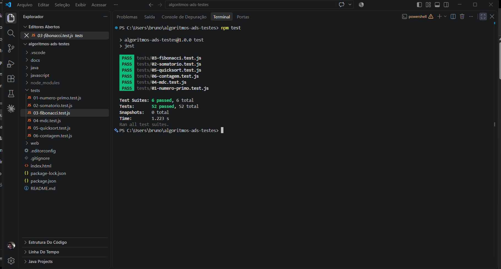

# Algoritmos — Análise e Desenvolvimento de Sistemas

Implementação de seis algoritmos clássicos em **JavaScript** e **Java**, com padronização
de código via **EditorConfig**, testes unitários automatizados com **Jest** e versionamento
no **GitHub**.

| Entregável | Conteúdo |
| ---------- | -------- |
| #1 | algoritmos em JavaScript e Java, EditorConfig e repositório no GitHub |
| #2 | vídeo de depuração no VS Code, interface web para executar os algoritmos e publicação no GitHub |
| #3 | testes unitários com Jest (`npm test`), revisão com programação defensiva e sincronização no GitHub |

- **Repositório da atividade anterior:** https://github.com/brunovasr/algoritmos-ads
- **Interface web (publicada no repositório anterior):** https://brunovasr.github.io/algoritmos-ads/web/
- **Vídeo da depuração:** https://share.vidyard.com/watch/3dCoGoz4K5HdHvsVdfMLDT
- **Documentação do Jest:** https://jestjs.io/docs/getting-started

## Estrutura do projeto

```
algoritmos-ads-testes/
├── .editorconfig            # padronização de formatação do código
├── .gitignore
├── package.json             # script "npm test" e dependência do Jest
├── package-lock.json        # versões exatas das dependências (gerado pelo npm)
├── index.html               # redireciona para a interface web (GitHub Pages)
├── .vscode/
│   ├── extensions.json      # extensões recomendadas do VS Code
│   └── launch.json          # configurações de depuração (F5)
├── docs/
│   ├── roteiro-video-depuracao.md
│   └── prints/
│       └── resultado-npm-test.png   # print da execução dos testes (npm test)
├── web/                     # interface web (front-end)
│   ├── index.html
│   ├── style.css
│   ├── app.js
│   ├── algoritmos.jar       # classes Java compiladas, executadas no navegador (CheerpJ)
│   └── java/
│       ├── PonteWeb.java    # ponte entre a interface e as classes da pasta java/
│       └── compilar.sh      # gera o algoritmos.jar
├── javascript/
│   ├── 01-numero-primo.js
│   ├── 02-somatorio.js
│   ├── 03-fibonacci.js
│   ├── 04-mdc.js
│   ├── 05-quicksort.js
│   └── 06-contagem.js
├── tests/                   # testes unitários (Jest), um arquivo por algoritmo
│   ├── 01-numero-primo.test.js
│   ├── 02-somatorio.test.js
│   ├── 03-fibonacci.test.js
│   ├── 04-mdc.test.js
│   ├── 05-quicksort.test.js
│   └── 06-contagem.test.js
├── java/
│   ├── NumeroPrimo.java
│   ├── Somatorio.java
│   ├── Fibonacci.java
│   ├── Mdc.java
│   ├── Quicksort.java
│   └── Contagem.java
└── README.md
```

---

## Os algoritmos

### 1. Número primo

Um número inteiro positivo `n` é primo quando é divisível apenas por 1 e por ele mesmo.
Por definição, 0 e 1 não são primos.

A verificação testa divisores apenas até a **raiz quadrada de n**: se `n = a × b`, um dos
fatores é obrigatoriamente menor ou igual a `√n`. Também descartamos os pares logo no
início, testando depois apenas os divisores ímpares.

- Complexidade: **O(√n)**

### 2. Somatório

Soma de um conjunto de números. Foram implementadas três versões:

| Versão | Descrição | Complexidade |
| --- | --- | --- |
| Iterativa | percorre o vetor acumulando os valores | O(n) |
| Recursiva | soma o primeiro elemento com o somatório do restante | O(n) |
| Fórmula de Gauss | soma de 1 até n: `n × (n + 1) / 2` | O(1) |

### 3. Fibonacci

Sequência em que cada termo, a partir do terceiro, é a soma dos dois anteriores:
`0, 1, 1, 2, 3, 5, 8, 13, 21, 34 …`

```
F(0) = 0
F(1) = 1
F(n) = F(n - 1) + F(n - 2), para n > 1
```

A versão **iterativa** guarda apenas os dois últimos termos — O(n). A versão **recursiva**
é incluída para fins didáticos, mas recalcula os mesmos termos várias vezes — O(2ⁿ).

### 4. Máximo divisor comum (MDC)

O MDC de dois inteiros `a` e `b` é o maior inteiro que divide ambos. Usamos o
**Algoritmo de Euclides**:

```
mdc(a, b) = mdc(b, a mod b)   →   até que o resto seja zero
```

Exemplo com 48 e 18: `48 mod 18 = 12` → `18 mod 12 = 6` → `12 mod 6 = 0` → **MDC = 6**.

- Complexidade: **O(log(min(a, b)))**
- Como bônus, o MMC é calculado a partir do MDC: `mmc(a, b) = |a × b| / mdc(a, b)`

### 5. Ordenação — Quicksort

Algoritmo de **divisão e conquista**:

1. escolhe um elemento como **pivô** (usamos o último elemento — partição de Lomuto);
2. reorganiza o vetor deixando à esquerda os menores ou iguais ao pivô e à direita os maiores;
3. aplica o mesmo processo recursivamente nas duas metades.

- Complexidade: **O(n log n)** no caso médio, **O(n²)** no pior caso
- Ordenação *in-place* (não usa vetor auxiliar). A função `ordenar()` devolve uma cópia
  ordenada, preservando o vetor original.

### 6. Contagem

Dado um conjunto com N dados de entrada, contar quantos valores inteiros existem no
conjunto, do primeiro dado (inclusive) até o dado N (inclusive). Foram implementadas as
duas leituras possíveis do enunciado:

- **(a) `contarInteiros`** — percorre as N posições e conta quantos valores são números inteiros;
- **(b) `contarNoIntervalo`** — conta quantos valores estão dentro do intervalo numérico
  `[primeiro valor, N]`.

- Complexidade: **O(n)** em ambas

---

## Como executar

### JavaScript (Node.js)

Requer o [Node.js](https://nodejs.org) instalado (`node -v` para conferir).

```bash
cd javascript

node 01-numero-primo.js
node 02-somatorio.js
node 03-fibonacci.js
node 04-mdc.js
node 05-quicksort.js
node 06-contagem.js
```

No VS Code também é possível abrir o arquivo e pressionar **F5** (Run and Debug) ou usar
a extensão *Code Runner* (`Ctrl+Alt+N`).

### Java

Requer o JDK 17 ou superior (`java -version` para conferir).

```bash
cd java

javac NumeroPrimo.java && java NumeroPrimo
javac Somatorio.java  && java Somatorio
javac Fibonacci.java  && java Fibonacci
javac Mdc.java        && java Mdc
javac Quicksort.java  && java Quicksort
javac Contagem.java   && java Contagem
```

Para compilar tudo de uma vez em uma pasta separada:

```bash
javac -d out *.java
java -cp out NumeroPrimo
```

> A partir do Java 11 também é possível rodar direto, sem compilar: `java NumeroPrimo.java`

---

## Testes automatizados

Os algoritmos em JavaScript têm testes unitários escritos com o [Jest](https://jestjs.io/docs/getting-started),
um arquivo por algoritmo na pasta `tests/`. São **52 testes** no total, com pelo menos dois por
algoritmo, cobrindo resultados esperados, casos de borda (vazio, zero, negativos) e entradas inválidas.

### Como executar os testes

Requer o [Node.js](https://nodejs.org) instalado (`node -v` para conferir). Na raiz do projeto:

```bash
npm install
npm test
```

O `npm install` baixa o Jest (somente na primeira vez) e o `npm test` executa todos os testes.
Resultado esperado:

```
 PASS  tests/01-numero-primo.test.js
 PASS  tests/02-somatorio.test.js
 PASS  tests/03-fibonacci.test.js
 PASS  tests/04-mdc.test.js
 PASS  tests/05-quicksort.test.js
 PASS  tests/06-contagem.test.js

Test Suites: 6 passed, 6 total
Tests:       52 passed, 52 total
```

Execução real no VS Code, com os seis arquivos de teste da pasta `tests/` passando:



Para rodar os testes de um único algoritmo, ou acompanhar as mudanças em tempo real:

```bash
npx jest tests/03-fibonacci.test.js
npx jest --watch
```

No VS Code, rode os comandos acima no terminal integrado (`Ctrl+'`).

### Exemplo de teste

Cada teste importa a função da pasta `javascript/` e compara o resultado obtido com o esperado:

```js
const { fibonacciSerie } = require('../javascript/03-fibonacci');

test('os 10 primeiros números da contagem de fibonacci devem ser os corretos', () => {
  expect(fibonacciSerie(10)).toEqual([0, 1, 1, 2, 3, 5, 8, 13, 21, 34]);
});
```

### Programação defensiva

Os algoritmos foram revisados seguindo boas práticas de *clean code*, e os testes verificam cada uma:

- **nomes significativos:** variáveis como `dividendo`, `divisor`, `posicao` e `quantidade`
  no lugar de `x`, `y`, `i` e `n`;
- **validação de entrada:** cada função confere o tipo e a faixa dos argumentos antes de processar;
- **tratamento de exceções:** entradas inválidas lançam `TypeError` (tipo errado, como texto ou
  decimal onde se espera um inteiro) ou `RangeError` (valor fora da faixa, como posição negativa
  no Fibonacci), sempre com uma mensagem que explica o problema;
- **limites de precisão:** o Fibonacci recusa posições acima de 78 (o JavaScript perde exatidão
  a partir daí) e o MMC recusa resultados que não cabem em um inteiro seguro;
- **funções auxiliares:** a validação das versões recursivas roda uma única vez, fora da recursão.

Funções como `ehPrimo` e `contarNoIntervalo` mantêm um comportamento documentado para entradas
sem sentido (por exemplo, `ehPrimo('7')` devolve `false`), pois a interface web depende disso.

---

## Interface web

A pasta `web/` contém uma página que executa os seis algoritmos pelo navegador. Ela **não
reescreve** os algoritmos: o `web/index.html` carrega os próprios arquivos da pasta
`javascript/` com `<script src="../javascript/...">`, e o `web/app.js` só lê os campos,
chama as funções e mostra o resultado.

Para isso funcionar nos dois ambientes, cada arquivo de `javascript/` agora:

- executa o bloco de testes apenas quando roda direto no Node
  (`require.main === module`), então o navegador não imprime nada;
- só usa `module.exports` quando ele existe; no navegador as funções ficam globais.

A lógica dos algoritmos não mudou, e `node 01-numero-primo.js` continua funcionando igual.

### Rodando em JavaScript ou em Java

No topo da página há o seletor **Rodar em: JavaScript | Java**. A escolha fica salva no
navegador e também pode vir pelo endereço (`web/?linguagem=java#fibonacci`).

- **JavaScript:** chama as funções dos arquivos da pasta `javascript/`, como antes.
- **Java:** executa as classes da pasta `java/` dentro do próprio navegador, sem servidor,
  usando o [CheerpJ](https://cheerpj.com/) (uma máquina virtual Java em WebAssembly).
  As classes são compiladas em `web/algoritmos.jar` junto com `web/java/PonteWeb.java`,
  que só converte as entradas, chama os métodos originais e mede o tempo com
  `System.nanoTime()`. Na primeira execução o navegador baixa a JVM, o que leva alguns segundos.

Os limites dos campos acompanham os tipos de cada linguagem: no Java, `ehPrimo` recebe `int`,
o Fibonacci vai até a posição 92 (limite do `long`), e o Somatório e o Quicksort usam `int[]`
(só inteiros). Na Contagem o vetor Java é `double[]`, por isso não aceita textos.

Sempre que alterar algum arquivo da pasta `java/`, gere o `.jar` de novo:

```bash
bash web/java/compilar.sh
```

O que a página oferece:

- formulário para cada função, com validação das entradas e mensagens de erro;
- valor de retorno e tempo de execução de cada chamada, útil para comparar
  Fibonacci iterativo × recursivo e Gauss × soma um a um;
- tabela com os passos do Algoritmo de Euclides no MDC;
- gráfico de barras antes e depois no Quicksort, com botão para sortear valores;
- classificação visual de cada dado na Contagem;
- links diretos por algoritmo (`web/index.html#fibonacci`), tema claro/escuro automático
  e layout para celular.

### Como abrir

Não precisa instalar nada. Qualquer uma das opções funciona:

1. dar dois cliques em `web/index.html` (só o modo JavaScript; o modo Java precisa de um
   servidor, então use uma das opções abaixo);
2. no VS Code, com a extensão **Live Server**, clicar com o botão direito em
   `web/index.html` → **Open with Live Server**;
3. pelo terminal, na raiz do projeto: `npx serve .` e abrir `http://localhost:3000/web/`.

### Publicando no GitHub Pages

1. No repositório, abra **Settings → Pages**;
2. em **Build and deployment**, escolha **Deploy from a branch**;
3. selecione a branch `main`, a pasta `/ (root)` e clique em **Save**;
4. em cerca de um minuto a página fica disponível em
   `https://brunovasr.github.io/algoritmos-ads/` (a raiz redireciona para `web/`).

---

## Depuração no VS Code

O arquivo `.vscode/launch.json` traz três configurações, escolhidas no topo do painel
**Run and Debug** (`Ctrl+Shift+D`):

| Configuração | Uso |
| ------------ | --- |
| JS: depurar arquivo atual | roda o `.js` aberto e para nos breakpoints |
| JS: depurar arquivo atual (parar na primeira linha) | pausa no início sem nenhum breakpoint, ideal para usar o *step into* |
| Java: depurar arquivo atual | roda o `.java` aberto (requer o Extension Pack for Java) |

O passo a passo usado no vídeo (execução passo a passo, *step into* sem breakpoint,
alteração de variáveis pelo *Debug Console* e breakpoint condicional) está em
[`docs/roteiro-video-depuracao.md`](docs/roteiro-video-depuracao.md).

---

## Configurando o EditorConfig no VS Code

O **EditorConfig** garante que todos que abrirem o projeto usem a mesma formatação
(indentação, codificação, fim de linha), independentemente do editor ou do sistema operacional.

**Passo 1 — instalar a extensão**

1. Abra o VS Code e pressione `Ctrl+Shift+X` (Extensões);
2. pesquise por **EditorConfig for VS Code** (publicado por *EditorConfig*);
3. clique em **Install**.

**Passo 2 — o arquivo `.editorconfig`**

Ele já está na raiz deste projeto. Para criar em outro projeto, clique com o botão direito
na raiz → **Generate .editorconfig**, ou crie o arquivo manualmente:

```ini
root = true

[*]
charset = utf-8
end_of_line = lf
insert_final_newline = true
trim_trailing_whitespace = true
indent_style = space
indent_size = 4
max_line_length = 100

[*.{js,json}]
indent_size = 2

[*.java]
indent_size = 4

[*.md]
trim_trailing_whitespace = false
```

**Passo 3 — testar**

Abra qualquer arquivo `.js`, aperte `Tab` e confira na barra inferior do VS Code:
deve aparecer **Spaces: 2**. Nos arquivos `.java`, **Spaces: 4**. Salvar o arquivo
(`Ctrl+S`) remove automaticamente os espaços em branco no fim das linhas.

### O que cada propriedade faz

| Propriedade | Função |
| --- | --- |
| `root = true` | indica que este é o arquivo de configuração de nível mais alto |
| `charset` | codificação dos caracteres (utf-8) |
| `end_of_line` | caractere de quebra de linha (`lf` = padrão Linux/macOS/Git) |
| `insert_final_newline` | garante uma linha em branco no fim do arquivo |
| `trim_trailing_whitespace` | remove espaços sobrando no fim das linhas |
| `indent_style` / `indent_size` | tipo e tamanho da indentação |
| `max_line_length` | comprimento máximo sugerido para a linha |

---

## Sincronizando com o GitHub

### Opção A — pela interface do VS Code

1. Abra a pasta do projeto no VS Code (**File → Open Folder**);
2. clique no ícone **Source Control** na barra lateral (`Ctrl+Shift+G`);
3. clique em **Initialize Repository**;
4. escreva a mensagem do commit (ex.: `feat: implementa os seis algoritmos em JS e Java`)
   e clique em **Commit**;
5. clique em **Publish Branch** → escolha **Publish to GitHub public repository**;
6. faça login na conta do GitHub quando o VS Code solicitar e confirme o nome do repositório.

Pronto — o repositório aparece em `https://github.com/brunovasr/algoritmos-ads`.

### Opção B — pelo terminal

```bash
# dentro da pasta do projeto
git init
git add .
git commit -m "feat: implementa os seis algoritmos em JavaScript e Java"
git branch -M main

# crie o repositório vazio em https://github.com/new e cole a URL abaixo
git remote add origin https://github.com/brunovasr/algoritmos-ads.git
git push -u origin main
```

### Enviando alterações seguintes

```bash
git add .
git commit -m "docs: atualiza o README"
git push
```

No VS Code, o mesmo é feito pelo painel **Source Control**: escrever a mensagem →
**Commit** → **Sync Changes**.

---

## Ambiente utilizado

- Visual Studio Code
- Node.js (JavaScript)
- JDK 21 (Java)
- Navegador (Chrome, Edge ou Firefox) para a interface web
- Extensões: EditorConfig for VS Code, Extension Pack for Java, Live Server
